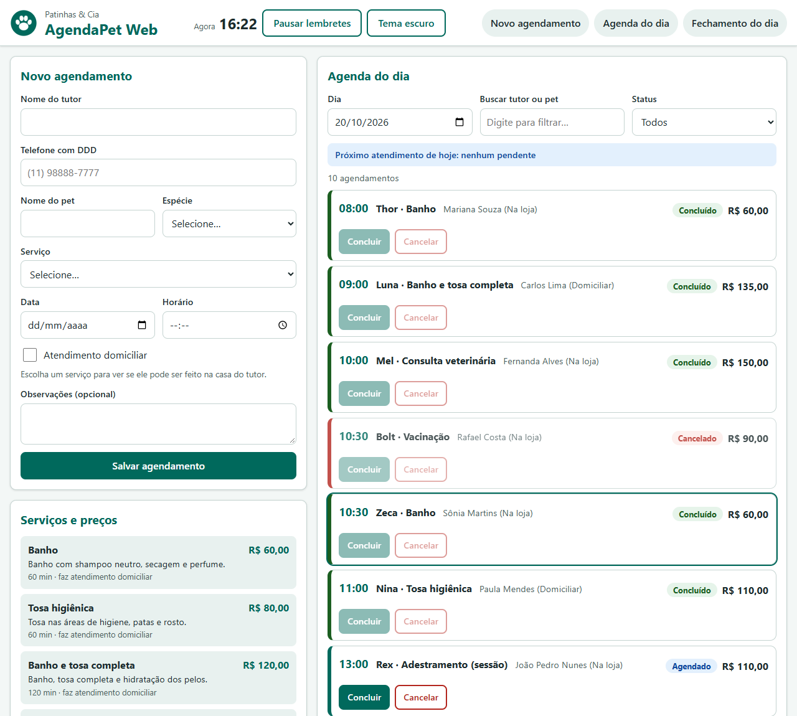

# AgendaPet Web 🐾

Painel web de agendamentos do pet shop **Patinhas & Cia** (empresa fictícia). Mini-projeto avaliativo do Módulo 01 (Semanas 13 e 14), feito em **HTML, CSS e JavaScript puros** + **scripts Node.js**.

> 🎥 **Vídeo da Sprint Review:** _cole aqui o link (Google Drive em modo leitor ou YouTube não listado)_
> 📋 **Quadro Kanban:** _cole aqui o link do Trello / GitHub Projects / Notion_ (print em [docs/kanban.png](docs/kanban.png))

---

## 1. O que o sistema faz e para quem serve

A atendente do pet shop usa o painel (no celular ou tablet, na bancada) para:

- ver o **catálogo de serviços** com preço e duração (carregado por `fetch` de um JSON);
- **agendar** atendimentos com validação (data, horário de funcionamento, telefone…);
- preencher o endereço de atendimentos **a domicílio** só com o **CEP** (API ViaCEP);
- ser **avisada de feriados** na data escolhida (API BrasilAPI), com cache;
- acompanhar a **agenda do dia** (busca, filtro por status, concluir/cancelar, atalhos de teclado);
- receber **lembretes** de atendimentos próximos e ver os **atrasados** em destaque;
- ver o **fechamento do dia** (faturamento, a receber, atendimentos por serviço);
- **exportar** a agenda em JSON e **fechar o dia pelo terminal** com Node.js.

Tudo fica salvo no navegador (`localStorage`) — ao recarregar a página nada se perde.



## 2. Como executar (do zero)

Pré-requisitos: [Node.js](https://nodejs.org) 20 ou superior e Git.

```bash
git clone <url-do-seu-repositorio>
cd agendapet-web
npm install          # instala a dependência de desenvolvimento (http-server)
npm start            # sobe o servidor local em http://localhost:5500 e abre o navegador
```

> ⚠️ Não abra o `index.html` com duplo clique (`file://`): `fetch` e módulos ES precisam de um servidor (por isso o `npm start`).

| Comando | O que faz |
|---|---|
| `npm start` | Servidor local da página (porta 5500) |
| `npm run fechamento` | Relatório do fechamento do dia **no terminal** (usa `data/agenda-exemplo.json`, dia 20/10/2026). Outra data/arquivo: `node scripts/fechamento-dia.js --data=2026-10-21` |
| `npm run validar` | Valida `data/agenda-exemplo.json` (CommonJS). Sai com **código 0** se estiver tudo certo |
| `npm run validar:erro` | Valida `data/agenda-invalida.json`: mostra os erros e sai com **código 1** |
| `npm test` | Testes do domínio com o executor nativo do Node (`node --test`) |

**Para ver a página cheia:** clique em **"Carregar dados de exemplo"** (seção Fechamento) — a agenda do dia 20/10/2026 aparece pronta.

**Para simular falha do catálogo (demonstração):** abra `http://localhost:5500/?simularErro=servicos` — a página mostra o erro com o botão "Tentar novamente".

**Atalhos de teclado:** `N` vai ao formulário · `/` foca a busca · `Esc` limpa a busca.

## 3. Decisões de negócio

| Decisão | Valor | Onde está |
|---|---|---|
| Funcionamento | 08:00 às 18:00, horários de 30 em 30 min. O serviço precisa **terminar** até 18:00 (banho e tosa de 120 min às 17:00 não cabe) | `CONFIG` em `js/dominio/agendamento.js` |
| Conflito de horário | Dois agendamentos **ativos** (Agendado ou Concluído) no mesmo dia e hora não podem coexistir. **Cancelado libera** o horário | `conflitaCom()` e `temConflito()` |
| Taxa domiciliar | R$ 15,00 se a casa é em **São Paulo/SP** (cidade da loja); R$ 30,00 em outra cidade | `AgendamentoDomiciliar.taxaDeslocamento()` |
| Quem pode ser domiciliar | Só serviços marcados `"domiciliar": true` no `servicos.json` (adestramento e hospedagem são só na loja) | `servicos.json` + `validarAgendamento()` |
| Faturamento | Soma só dos **Concluídos** (com taxa). "A receber" soma os **Agendados** | `calcularFechamento()` |
| Protocolo | `AP-0001`, `AP-0002`… sequencial; continua do maior número já salvo | `criarGeradorProtocolo()` |
| Feriados | Consulta a BrasilAPI por ano; cache de **30 dias** no `localStorage`. Em feriado, é preciso marcar "Agendar mesmo assim" | `api.js` / `storage.js` |
| Se as APIs falharem | **Nunca bloqueiam** o trabalho: CEP → preenchimento manual; feriados → aviso e segue; serviços → botão "Tentar novamente" | `app.js` |
| Lembretes | Atualiza a cada 30 s; avisa quando faltam **15 min** ou menos; "Atrasado" = ainda Agendado e o horário passou | `atualizarRelogio()` |

## 4. Conceitos do Módulo 01: onde foram aplicados

| Conceito | Onde |
|---|---|
| HTML semântico, acessibilidade e SEO | `index.html`: `header`, `nav`, `main`, `section`, `aside`, `footer`; um só `h1`; `lang`; `meta description`; skip link; `label`/`aria-describedby`/`aria-live`/`role` |
| Formulários + JavaScript | `submit` com `preventDefault`, validação com mensagens na tela e foco no 1º erro — `app.js` (`aoEnviar`), `regras.js` (`validarAgendamento`) |
| CSS, Flexbox, variáveis, responsividade | `css/style.css` (mobile-first, breakpoints 640px e 1024px, tema escuro por variáveis) |
| DOM e seletores | `ui.js`: `createElement`, `textContent`, `classList`, `querySelector(All)`, `getElementById` |
| Eventos de mouse e teclado | `app.js`: `click`, `mouseover/mouseout` (delegação), `input`, `keydown` (atalhos) |
| `fetch` + `async/await` + Promises | `api.js` (serviços, ViaCEP, BrasilAPI) com 3 estados e erros por tipo (`ErroApi`) |
| `localStorage` | `storage.js` (agenda, filtro, tema, cache de feriados) com `try/catch` |
| `setTimeout` / `setInterval` | `ui.js` (toast some em 4 s) · `app.js` (relógio/lembretes a cada 30 s com `clearInterval`; confirmação de "limpar" por 4 s) |
| Classes, construtor, `this` | `Servico`, `Agendamento` em `agendamento.js` |
| Herança | `AgendamentoDomiciliar extends Agendamento` (acrescenta `endereco`, sobrescreve `calcularValor()` e `resumo()`) |
| Closure | `criarGeradorProtocolo()` — o contador fica preso na função |
| Callback | `filtrarAgendamentos(lista, ...criterios)` recebe funções (`porStatus`, `porBusca`) |
| Métodos de array | `filter`, `map`, `find`, `some`, `every`, `reduce`, `sort` em `fechamento.js` |
| Laços | `for...of` (`montarLinhasRelatorio`) e `for` aninhado (`validar-agenda.cjs`) |
| Estruturas de decisão | `if/else`, `switch` (`aoClicarNaAgenda`), operador ternário (`ui.js`) |
| `const`, `let` e `var` | Usei `const` por padrão e `let` só quando o valor muda. **`var` não é usado**: ele tem escopo de função (não de bloco) e sofre _hoisting_, o que gera bugs difíceis; `let`/`const` resolvem isso |
| Módulos ESM | `export`/`import` em todo `js/` e `scripts/fechamento-dia.js`; `<script type="module">` no HTML |
| Node.js, npm, CommonJS | `package.json`, `scripts/validar-agenda.cjs`, `scripts/fechamento-dia.js` |
| Depuração no VS Code | `.vscode/launch.json` + [docs/bug-report.md](docs/bug-report.md) |

## 5. Arquitetura cliente-servidor neste projeto

No modelo **cliente-servidor**, o **cliente** (o navegador) pede e o **servidor** responde. Aqui há três servidores diferentes:

```
Navegador (cliente)
   │ GET data/servicos.json ───────────► servidor local (http-server, npm start)
   │ GET viacep.com.br/ws/{cep}/json ──► servidor do ViaCEP (internet)
   │ GET brasilapi.com.br/api/feriados ─► servidor da BrasilAPI (internet)
   └ localStorage ─────────────────────► guarda dados NO navegador (não é servidor)
```

O `fetch` devolve uma **Promise**: a página não trava esperando, e por isso mostramos os três estados (**carregando → sucesso ou erro**). Falhas de rede (`fetch` rejeita), erros HTTP (`response.ok` falso) e respostas "vazias" do ViaCEP (`{"erro": true}`) são tratados separadamente.

## 6. Gerenciadores de pacotes: instalação global vs local

| | Local (`npm install --save-dev http-server`) | Global (`npm install -g http-server`) |
|---|---|---|
| Onde fica | `node_modules/` **do projeto** | Pasta global do Node, vale para o computador |
| Registrado em | `package.json` (`devDependencies`) e `package-lock.json` | Em lugar nenhum do projeto |
| Quem tem a mesma versão | **Todo mundo que clonar** e rodar `npm install` | Só quem instalou manualmente |
| Quando usar | Ferramentas que o **projeto** precisa (servidor, testes, lint) | Ferramentas de uso geral na máquina (ex.: `npm`, `npx`, `serve`) |

**O que instalei e onde:** só **`http-server` localmente** (como `devDependency`, usado pelo `npm start`). Nada global — assim o projeto roda em qualquer máquina com `npm install`. Comandos úteis para conferir:

```bash
npm ls                 # dependências locais do projeto
npm ls -g --depth=0    # pacotes globais instalados na máquina
npx http-server --help # roda um pacote local (ou baixa e roda, sem instalar) com o npx
```

## 7. CommonJS vs ESM e por que usei ESM

| | CommonJS (CJS) | ES Modules (ESM) |
|---|---|---|
| Sintaxe | `const fs = require('node:fs')` / `module.exports = ...` | `import fs from 'node:fs'` / `export function ...` |
| Extensão | `.cjs` (ou `.js` sem `"type": "module"`) | `.mjs` (ou `.js` com `"type": "module"`) |
| Carregamento | Síncrono | Assíncrono (permite `await` no topo do arquivo) |
| Funciona no navegador? | **Não** | **Sim** (`<script type="module">`) |
| `__dirname` / `__filename` | Existem | **Não existem** — usa-se `import.meta.url` |
| Um chama o outro? | CJS carrega ESM só com `await import()` | ESM importa CJS normalmente |

**Por que ESM como padrão:** é o **mesmo** formato que o navegador entende. Assim, `js/dominio/` (classes e regras) é escrito **uma vez** e usado pela página **e** pelos scripts do terminal. O `package.json` declara `"type": "module"`.

**Onde uso CommonJS:** `scripts/validar-agenda.cjs` (usa `require`, `__dirname` e `process.exit(1)`). Para reaproveitar as regras do domínio (ESM), ele usa **`await import(...)` dinâmico** — a ponte que o CommonJS tem para carregar módulos ES.

## 8. Especificidade no CSS — um conflito real

Eu estilizei o botão de abrir/fechar detalhes do item com `.agenda button { background: none; }`. Os botões **Concluir** e **Cancelar** (`.botao--principal`, `.botao--perigo`) ficaram sem cor de fundo, mesmo declarados depois.

**Causa:** especificidade. `.agenda button` = classe + tag = **(0,1,1)**; `.botao--principal` = só classe = **(0,1,0)**. Quem tem maior especificidade vence, independente da ordem.

**Solução:** troquei o seletor de tag por uma classe própria, `.item__toggle` (0,1,0). Agora todas as regras têm a mesma especificidade e a **ordem do arquivo** decide. Sem `!important` e sem seletores de id.

## 9. Depuração no VS Code

Usei o depurador (F5 com `.vscode/launch.json`) para achar por que o fechamento do dia mostrava **R$ 900,00** de faturamento quando só **R$ 515,00** estavam concluídos. Resumo e evidências em [docs/bug-report.md](docs/bug-report.md) (print em [docs/depuracao.png](docs/depuracao.png)).

## 10. Sprint: planejado × entregue

Meta da sprint: _"a atendente consegue agendar com validação, acompanhar a agenda do dia e fechar o caixa, no celular, e o dono fecha o dia pelo terminal"_. Detalhes em [planejamento/sprint-planning.md](planejamento/sprint-planning.md).

| | |
|---|---|
| Tickets planejados | 12 (US01 a US12) |
| Pontos planejados | 47 |
| Pontos entregues | 47 |
| Ficou de fora | Nada do escopo obrigatório. Bônus entregues: testes com `node --test`, download da agenda, estilos de impressão |
| Branches / Pull Requests | 9 branches, 9 PRs (padrão `tipo/US##-descrição`) |

### Retrospectiva

- **O que manter:** um ticket por branch com PR e print; estimar antes de começar (as estimativas de US07 e US03 estavam certas); testar o domínio no Node antes de ligar na tela.
- **O que parar de fazer:** deixar a regra de negócio dentro de `app.js` no começo (tive de refatorar para `js/dominio/`); usar seletores de tag no CSS (foi a causa do conflito de especificidade).
- **O que começar a fazer:** escrever o teste **antes** da correção de bug; abrir PRs menores; conferir o layout em 360px a cada ticket, não só no fim.
- **Aprendizado:** o carregamento do exemplo gerava protocolos repetidos quando a agenda já tinha dados — descobri ao testar o fluxo completo e corrigi gerando números a partir do **maior** entre os dois conjuntos.

## 11. Extensões do VS Code

Usadas/recomendadas: **Live Server** (alternativa ao `npm start`), **ESLint**, **Prettier**, **Edge/Chrome Debugger** (já embutido no VS Code) e **GitLens**.

## 12. Estrutura do projeto

```
agendapet-web/
├── index.html
├── package.json · package-lock.json · .gitignore
├── css/style.css
├── data/ servicos.json · agenda-exemplo.json · agenda-invalida.json
├── img/ logo.svg · favicon.svg
├── js/
│   ├── app.js        (maestro: estado e eventos)
│   ├── ui.js         (DOM)
│   ├── api.js        (fetch)
│   ├── storage.js    (localStorage)
│   └── dominio/      (sem DOM: roda no navegador e no Node)
│       ├── agendamento.js  (CONFIG, classes, closure do protocolo)
│       ├── regras.js       (validações, datas, conflito, feriado)
│       └── fechamento.js   (métodos de array, callbacks, relatório)
├── scripts/ fechamento-dia.js (ESM) · validar-agenda.cjs (CommonJS)
├── tests/dominio.test.js
├── .vscode/launch.json · .github/pull_request_template.md
├── planejamento/sprint-planning.md
└── docs/ kanban.png · depuracao.png · bug-report.md · tela-1280.png
```

## 13. Branches e Pull Requests

| Branch | Objetivo | PR |
|---|---|---|
| `chore/setup-projeto` | `npm init`, `.gitignore`, modelo de Pull Request, estrutura de pastas | #1 |
| `feat/US01-US10-html-css` | HTML semântico, layout Flexbox, responsividade e tema | #2 |
| `feat/US02-US03-catalogo-formulario` | Catálogo por `fetch` e formulário com validação | #3 |
| `feat/US04-US05-apis` | CEP (ViaCEP) e feriados (BrasilAPI) com cache | #4 |
| `feat/US06-US07-agenda-dominio` | Agenda do dia, classes, herança, conflito e fechamento | #5 |
| `feat/US08-US09-storage-timers` | `localStorage`, exportação, relógio e lembretes | #6 |
| `feat/US11-node-modulos` | Scripts npm, ESM, CommonJS e validação | #7 |
| `fix/US07-faturamento-concluidos` | Corrige o faturamento (bug do relatório) | #8 |
| `docs/readme-retrospectiva` | README, planejamento e relatório de bug | #9 |
